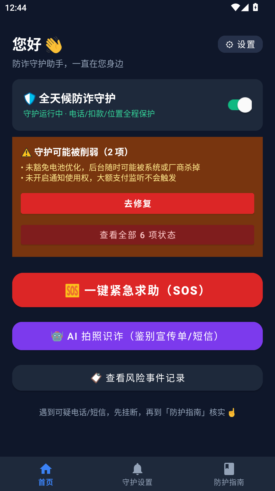
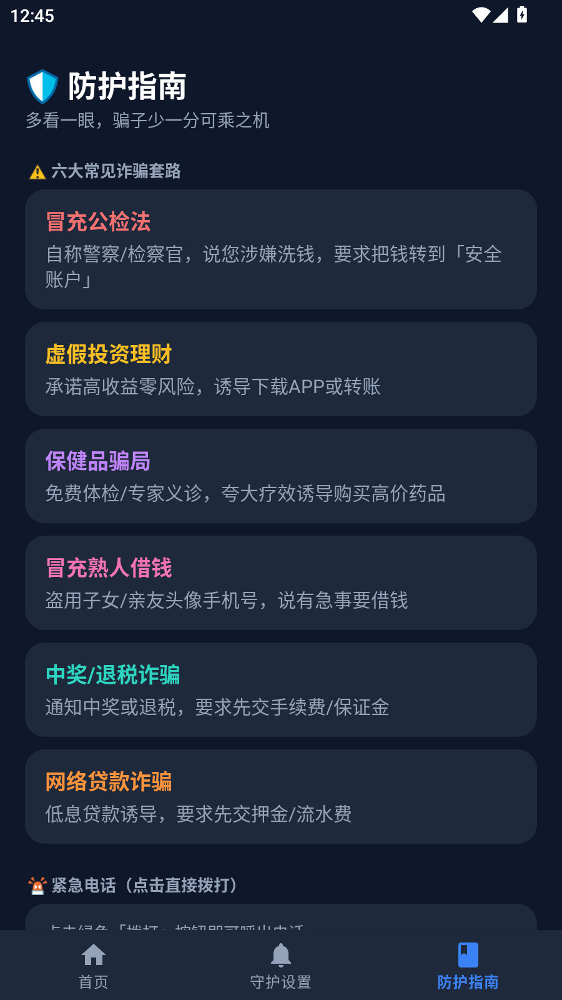
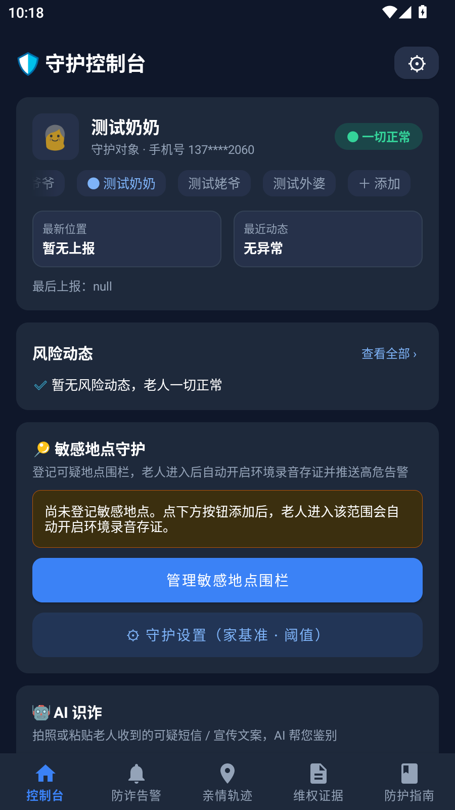

# 长者防诈守护 · Senior Anti-Fraud Guard

> 行为感知 → 实时干预 → 证据留存，三位一体守护家中老人，远离电信诈骗、保健品会销与养老投资骗局。

一个 App 同时扮演**老人端**与**子女端**两个角色：装在老人手机上无感感知风险（异常通话、敏感地点、异常扣款、跌倒），子女通过 App 或微信小程序实时接收告警、远程打断洗脑、一键打包报案证据。

---

## 界面截图

| 老人端 · 首页 | 老人端 · 防护指南 |
| :-: | :-: |
|  |  |
| 守护开关常驻运行，SOS 一键求助，AI 拍照识诈 | 六大常见诈骗套路速查 + 紧急电话直拨 |

| 子女端 · 守护控制台 | 微信小程序 |
| :-: | :-: |
|  |  |
| 被守护人状态、风险动态、敏感地点围栏一屏总览 | 微信扫码即用，免安装 |

## 核心能力

| 老人端（装在老人手机） | 子女端（自己的手机） | 云端（自动决策） |
| :- | :- | :- |
| 异常通话 / 长时通话监测 | 高危行为强提醒推送（穿透静音） | 规则引擎 + AI 研判定级 |
| 电子围栏与敏感地点停留感知 | 远程亲情语音打断（红色覆屏 + 预录语音） | 事件归一分级、三端同步打断规则 |
| 通知栏异常扣款捕获 | 亲情轨迹地图与停留证明 | 逆地理编码、ASR 转写 |
| 跌倒检测 + 分段场景录音存证 | 一键生成《报案维权证据包》 | 录音生命周期管理与清理 |

## 快速体验

### 方式一：微信小程序（免安装，推荐）

1. 微信扫描上方小程序码（子女端，免安装）；
2. 用手机号注册/登录，选择「子女端」角色；
3. 让老人在其手机安装 Android App 并登记，你在小程序里输入**老人绑定码**即可完成绑定，实时接收告警。

### 方式二：Android App（双端一体，同一安装包）

1. 从 [GitHub Releases](https://github.com/zengxiaoqi/senior-anti-fraud-guard/releases) 下载最新 APK（约 37MB，仅 arm64），或在已装 App 内直接自升级；
2. 安装后选择角色：**老人机选「老人端」，自己的手机选「子女端」**；
3. 老人端首次打开发放「守护开关」，按提示完成账号登记（已登记过的手机号可直登，绑定关系自动恢复）；
4. 子女端登录后输入老人端首页显示的**绑定码**，双方即完成绑定。

> 演示环境（本地）：`npm run start:demo` 后使用内置演示账号——老人绑定码 `246810` / 子女端 `135791`，自带 5 条风险事件、4 条位置、2 条支付存证样例。

## 本地开发

```bash
npm start            # 生产/本地服务（data.sqlite）
npm run start:demo   # 演示环境（data.demo.sqlite，纯假数据，自动生成）
npm test             # 143 个测试用例
```

后端 Node.js + Express + SQLite + WebSocket，**零构建步骤**；配置写在根目录 `.env`（模板 `.env.example`，缺配置只降级不崩）。开发环境搭建、打包发版、adb 调试详见 [docs/development-guide.md](docs/development-guide.md)。

## 技术栈

- **端**：Android Native（Kotlin / Jetpack，单 APK 双角色）+ 微信原生小程序 + Web 管理面板
- **后端**：Node.js + Express + SQLite + ws（本地）；Cloudflare Workers + D1 + R2 + KV + Cron（生产，同构镜像）
- **AI**：MLKit OCR（端侧）+ 可插拔多模态 LLM（ASR 转写 / 诈骗图文研判）

完整产品设计、架构、功能模块实现与合规方案见 **[docs/技术方案.md](docs/技术方案.md)**。

## 文档

| 文档 | 内容 |
| :- | :- |
| [docs/技术方案.md](docs/技术方案.md) | 痛点与设计原则、系统架构、功能模块、合规设计、技术栈 |
| [AGENT.MD](AGENT.MD) | 工程铁律与快速上手（改代码前必读） |
| [docs/development-guide.md](docs/development-guide.md) | 环境、命令、Android 高危坑、打包发版、adb 调试 |
| [docs/api-reference.md](docs/api-reference.md) | REST API、鉴权模型、事件类型、WebSocket 协议 |
| [docs/database-schema.md](docs/database-schema.md) | 表结构、证据保留策略、隐私红线 |
| [docs/ui-guidelines.md](docs/ui-guidelines.md) | UI 设计规范（语义色、文案真源、交互红线） |
| [docs/录音存证链路实现说明.md](docs/录音存证链路实现说明.md) | 录音 → 上传 → 转写 → AI 研判 → 收听全链路 |

## 合规声明

本系统基于**透明授权 + 系统公开 API + 高危状态界面告知**实现，不进行任何隐蔽偷录或侵入式窃听；敏感数据（录音、定位、支付信息）仅对绑定亲情账号可见，TLS 传输。详见 [docs/技术方案.md](docs/技术方案.md) §4。
